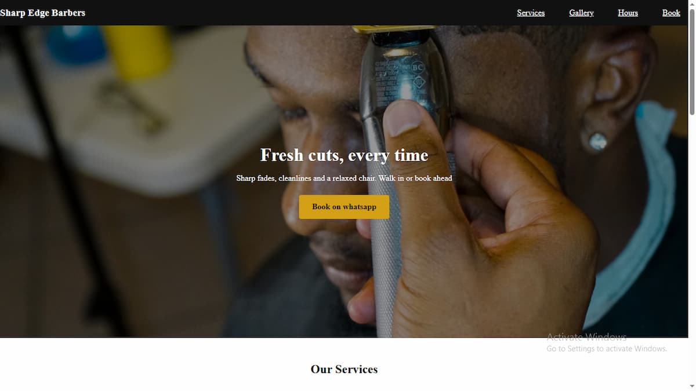

# Sharp Edge Barbers

A responsive landing page for a fictional barber shop, built with HTML, CSS and vanilla JavaScript.

**Live demo:** (add your link here after you deploy)

## Features
- Mobile-first, responsive layout with a hamburger menu
- Services and opening hours rendered from JavaScript arrays
- Image gallery slider with previous/next buttons
- Booking form with validation (name, Nigerian phone number, service, date)
- Today's opening hours highlighted automatically

## Built with
- HTML5
- CSS3 (Flexbox and Grid)
- JavaScript (ES6)

## What I learned
- Rendering lists from arrays of objects with `.map()`
- Validating form input and showing error messages
- Making a layout work on phones first and then larger screens
- Debugging with the browser's DevTools

## Run it locally
1. Download or clone this repository
2. Open the folder in VS Code
3. Open `index.html` with the Live Server extension

## Notes
This is a practice project. The business, reviews and photos are samples.